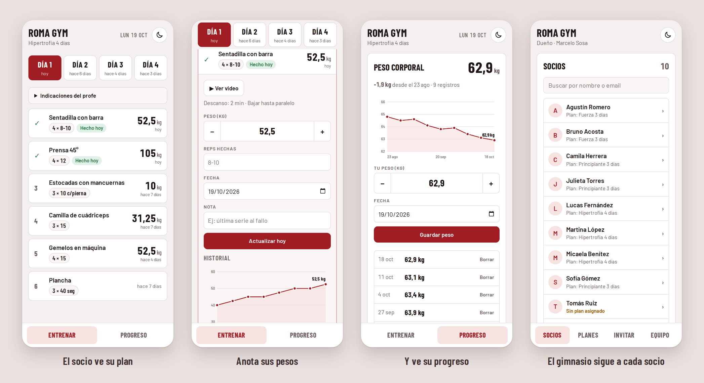
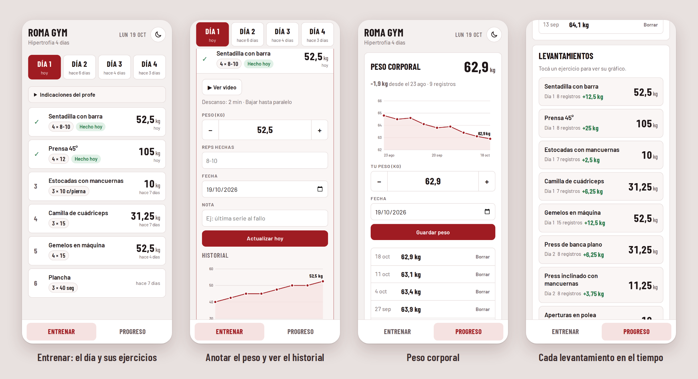
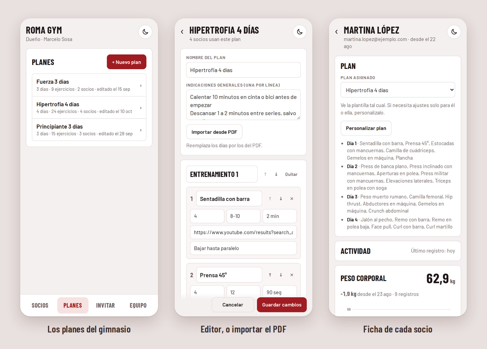
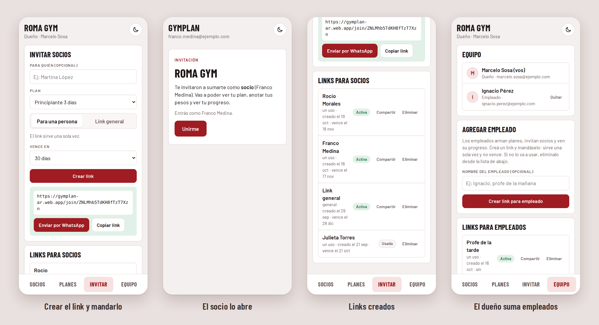
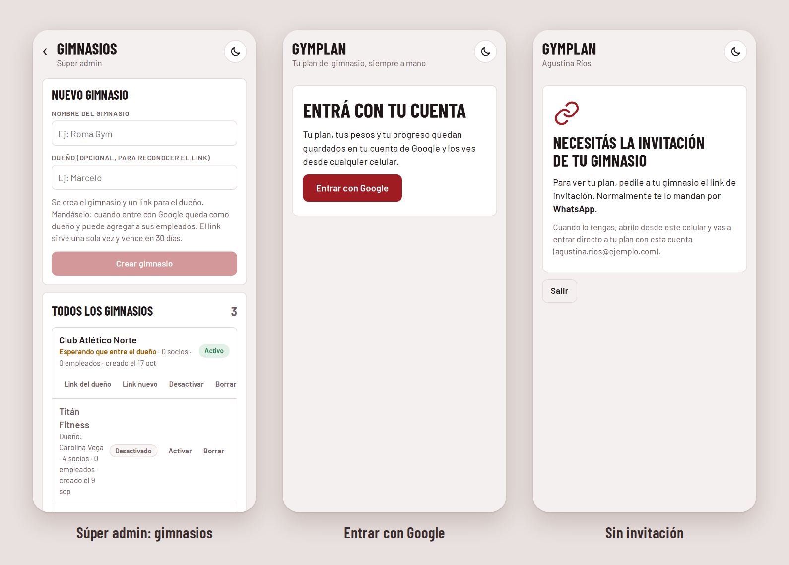
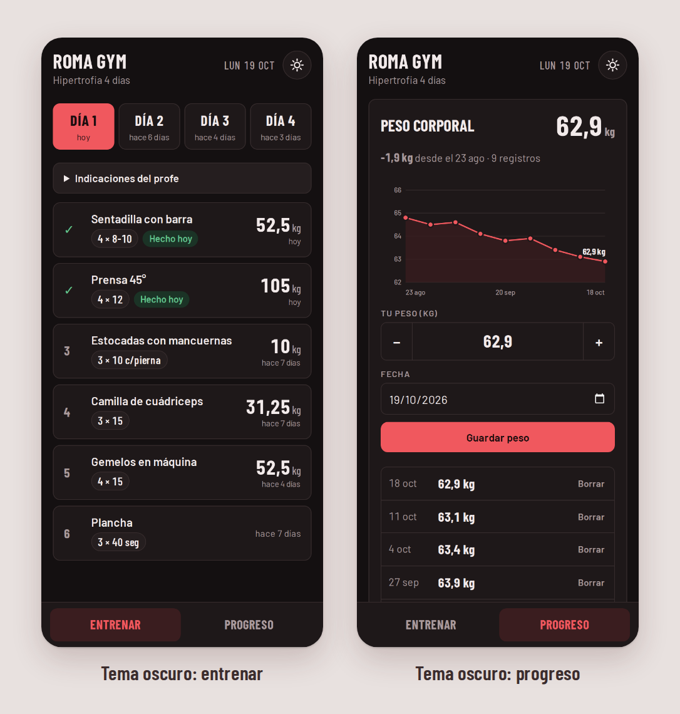

# GymPlan

Planes de entrenamiento para gimnasios, en el celular. El dueño y los profes arman los planes
(en un editor o importando el PDF que ya usan) y se los mandan a cada socio con un link por
WhatsApp. El socio entra con su cuenta de Google, ve su plan del día, anota los pesos que
levanta y ve cómo progresa.

**[Abrir GymPlan](https://gymplan-ar.web.app)** · se instala como app en Android · funciona
sin señal dentro del gimnasio



## Cómo funciona

1. **El gimnasio se da de alta.** El administrador de GymPlan crea el gimnasio y le manda al
   dueño un link. El dueño entra con Google y desde **Equipo** suma a sus profes.
2. **Se arman los planes.** Desde **Planes**, desde cero o importando el PDF de siempre. Un
   plan sirve para muchos socios (por ejemplo *Principiante 3 días*).
3. **Se invita a cada socio.** Desde **Invitar** se crea un link, con el plan ya asignado, y
   se manda por WhatsApp. El socio lo abre, entra con Google y ya ve su plan.
4. **El socio entrena y anota.** Cada día anota los pesos que hizo. El profe ve su progreso
   desde la ficha del socio.

No hace falta crear usuarios ni contraseñas: todos entran con su cuenta de Google, y el link
de invitación define a qué gimnasio y con qué rol se suman.

## Para el socio

### Entrenar
El plan está dividido en días (**Día 1**, **Día 2**…) y cada día muestra cuándo se hizo por
última vez. Cada ejercicio muestra las series y repeticiones, el último peso anotado y hace
cuánto. Lo que ya se hizo hoy queda marcado con ✓ **Hecho hoy**. Las **Indicaciones**
(calentar, descansos, cuándo subir el peso) están arriba de todo.

### Armar su propio plan
Si el profe todavía no le asignó un plan, el socio puede tocar **Armar mi plan** y cargarlo
a mano: los días, y en cada uno el nombre del ejercicio, las series, las repeticiones, el
descanso y alguna observación. También puede importar su PDF. Con **Editar mi plan**, debajo
de los ejercicios, lo cambia cuando quiera. Si tenía un plan del gimnasio, lo que edita pasa a
ser su plan personalizado y puede volver al del gimnasio cuando quiera.

### Anotar los pesos
Al tocar un ejercicio se abre: el botón **▶ Ver video** con la técnica, el descanso y las
observaciones del profe, y el formulario para anotar el **peso** (con − y + de a 2,5 kg), las
**repeticiones** hechas, la **fecha** y una **nota**. El peso viene cargado con el de la
última vez. Abajo está el **historial** con su gráfico. Si el profe cambia el plan pero el
ejercicio sigue, el historial continúa.

### Progreso
- **Peso corporal**: se anota cuando se quiere; muestra el gráfico y cuánto cambió desde el
  primer registro.
- **Levantamientos**: cada ejercicio con su último peso y cuánto subió; al tocarlo se ve su
  gráfico y el máximo.



## Para el dueño y los profes

### Planes
Un plan tiene un nombre, indicaciones generales y días con ejercicios (series, repeticiones,
descanso, link al video y observaciones). Los ejercicios que ya están en otros planes del
gimnasio se autocompletan con su video.

- **Importar desde PDF**: lee dos tipos de planilla. Se revisa y se guarda.
  - En lista: bloques *Entrenamiento 1, 2…* con las columnas *Ejercicio / Video / Series /
    Reps / Descanso / Observaciones*, links de video incluidos.
  - En grilla: una columna por día (*LUNES (tren inferior)*, *MARTES*…) y un ejercicio por
    celda, como *Press banca plano 3x8-10*. Las celdas **COMBINADOS** arman grupos de
    ejercicios que se hacen juntos (quedan como *Combinado 1, 2…* en las observaciones). Toma
    también el profe, el gimnasio, el nombre del alumno y las observaciones del encabezado.
- Al guardar un plan, **los socios que lo usan ven el cambio enseguida**. Cada versión queda
  guardada como historial.
- **Plan personalizado**: desde la ficha de un socio se ajusta el plan solo para esa persona.
  Desde ahí es independiente; con **Usar la plantilla** vuelve al plan común. Si el plan lo
  armó el mismo socio desde la app, la ficha lo indica.

### Socios
La lista de socios con su plan, con los que todavía no tienen plan resaltados. La **ficha de
cada socio** muestra su plan, cuándo anotó por última vez, su peso corporal y sus
levantamientos. Desde ahí se le cambia el plan o se lo da de baja.



### Invitar
- **Para una persona**: un link que sirve una sola vez, con el plan ya asignado.
- **Link general**: un link del gimnasio para cualquier socio nuevo, para compartir en el
  grupo de WhatsApp.
- Vencen en 7, 30 o 90 días, o en un año. **Enviar por WhatsApp** arma el mensaje con el link.
- La lista de links muestra si cada uno está **activo**, **usado** o **vencido**; se puede
  volver a compartir o eliminar.

### Equipo
Solo el dueño suma empleados: crea un link para cada uno (sirve una vez y no vence) y puede
quitarlos. Los empleados hacen todo lo demás: planes, invitaciones y seguimiento de socios.



## Roles

| Rol | Puede |
|---|---|
| **Socio** | Ver su plan o armarse uno propio, anotar sus pesos y su peso corporal, ver su progreso. |
| **Empleado** (profe) | Armar e importar planes, invitar socios, asignarles plan, ver su progreso. |
| **Dueño** | Todo lo del empleado, más sumar y quitar empleados. |
| **Súper admin** | Crear gimnasios, mandarle el link al dueño, desactivarlos o borrarlos. |

Una misma persona puede estar en varios gimnasios con roles distintos; en ese caso, al entrar
elige el gimnasio.

**Desactivar** un gimnasio corta el acceso de todos pero conserva los datos, y se puede
reactivar. **Borrar** lo elimina todo y pide escribir el nombre del gimnasio para confirmar.
Quien entra sin invitación ve un aviso de que necesita el link de su gimnasio.



## Detalles

- **Sin señal**: lo que se anota se guarda en el celular y se sincroniza solo cuando vuelve
  la conexión.
- **Se instala** como app desde Chrome en Android (*Agregar a la pantalla principal*) y se
  actualiza sola.
- **Tema claro u oscuro** con el botón de la luna; por defecto sigue al del celular.



---

## Desarrollo

React + TypeScript + Vite, con Firebase (Authentication con Google, Firestore y Hosting). No
hay servidor propio: los permisos de cada rol se controlan en las reglas de Firestore. El
detalle de roles, datos, invitaciones y reglas está en [DESIGN.md](DESIGN.md).

Requiere Node 22 (en WSL: `nvm use 22`).

```bash
npm install
npm run dev        # http://localhost:5173
npm run build      # compila en dist/
```

### Probar las reglas de seguridad

Usa el emulador de Firestore (necesita Java; en WSL está en `~/.local/jdk/current`).

```bash
npm run test:rules
```

Cubre: crear gimnasios, invitaciones (de un uso, generales, vencidas, desactivadas, de profe),
quién ve y edita cada plan, pesos de cada socio y cambios de rol.

### Capturas del README

```bash
npm run capturas
```

Levanta los emuladores de Auth y Firestore, carga un gimnasio de ejemplo (*Roma Gym*, con
planes, socios y dos meses de pesos de una socia), entra con cada rol y saca las capturas en
tamaño de celular. Deja las composiciones en `docs/capturas/` y cada pantalla suelta en
`docs/capturas/pantallas/` (no se sube a git). No toca los datos reales.

Los emuladores usan puertos propios (Auth 9299, Firestore 8180) para poder correr junto a los
de otros proyectos. Si Chromium no arranca por falta de `libnspr4.so`, hay que apuntar
`LD_LIBRARY_PATH` a las librerías que bajó Playwright:

```bash
LD_LIBRARY_PATH=~/.cache/ms-playwright/libs/root/usr/lib/x86_64-linux-gnu npm run capturas
```

Todo cambio visible en la app actualiza este README y las capturas.

### Publicar

```bash
npm run build
firebase deploy --only hosting           # la app
firebase deploy --only firestore:rules   # las reglas de seguridad
```

Proyecto de Firebase: `gymplan-ar` (Authentication con Google, Firestore en
`southamerica-east1`, Hosting).
